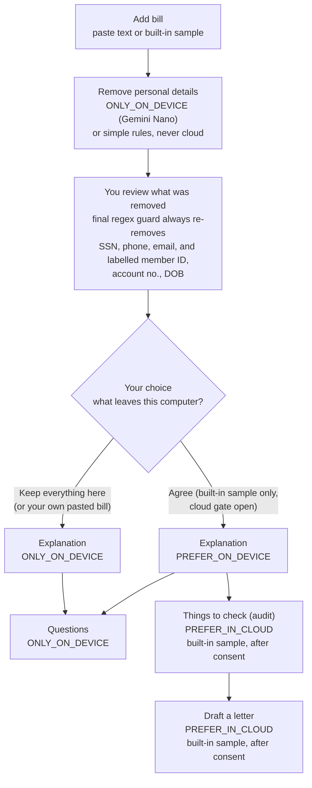

# ClearBill

ClearBill is a Chrome web app that explains US medical bills in plain language. It reads and redacts the bill on your computer with Gemini Nano (Chrome's built-in model), asks you to check what was removed, and only then, for the built-in synthetic sample bill and only if you agree, lets cloud Gemini run an audit and draft a letter. It uses Firebase AI Logic hybrid inference to move each step between the device and the cloud. A bill you paste yourself never leaves your computer.

Built for the #BuildHybridAI 2026 hackathon on Devpost (Web / Chrome category).

- Hosted URL: `https://clearbill-2c019.web.app` (**planned, not deployed yet. Placeholder: confirm after the Firebase Hosting deploy.**)
- Demo video: [TODO: add the public YouTube link]
- Devpost description: [`submission/devpost-description.md`](submission/devpost-description.md)

## Why hybrid

A medical bill is about as sensitive as text gets: names, birth dates, member IDs, diagnoses. A cloud model is stronger at checking arithmetic and drafting letters, but sending a raw bill to a cloud service is the wrong default. An on-device model keeps the text private and works offline, but it is smaller and slower to set up.

ClearBill uses each where it fits:

- **On the device (Gemini Nano):** finding and removing personal details, answering your questions, and (by default) explaining the charges.
- **In the cloud (Gemini through Firebase AI Logic):** the audit of the bill and the drafted letter, and only on the redacted text of the built-in synthetic sample, after you have seen the redaction and agreed. With consent, the explanation of the sample can also come from the cloud when Nano is not available. If a cloud call fails with a network or HTTP error (such as HTTP 500 "high demand") and Nano is available, the SDK answers on the device instead: the badge then reads "On this device", and the Under the hood row for that step shows "(Used a fallback)". A 45-second timeout, a blocked response or a malformed reply still shows an error card (a timeout does not trigger the on-device fallback; it shows the busy card, "Cloud AI is temporarily unavailable", with Try again). A failed call gets no row in Under the hood.
- **No model at all (simple rules):** if Gemini Nano is not available, regular expressions still find phone numbers, account numbers, emails and similar patterns, and ClearBill tells you it is using rules, not AI.

Every AI result carries a badge showing where it ran (On this device / In the cloud / Simple rules), and the "Under the hood" panel lists every completed call.

## How a bill moves through ClearBill



| Step | Firebase AI Logic mode | Where it can run | Needs consent |
|---|---|---|---|
| Remove personal details | `ONLY_ON_DEVICE`, or no model (rules) | Device only | No |
| Explanation | `PREFER_ON_DEVICE` if the cloud gate allows it, otherwise `ONLY_ON_DEVICE` | Device, or cloud for the sample | Only if it could reach the cloud |
| Questions | `ONLY_ON_DEVICE` | Device only | No |
| Audit, letter | `PREFER_IN_CLOUD` | Cloud (built-in sample only, after consent). If the cloud call fails with a network or HTTP error and Nano is available, the SDK answers on the device (badge "On this device", "(Used a fallback)" in Under the hood); a timeout (busy card, no fallback), blocked response or malformed reply shows an error card | Yes |

Sources: `src/ai/real/index.ts` (lines 191, 215, 223, 227, 232) and `design/flows.md` section 1.

## How Firebase AI Logic is used

Firebase AI Logic is imported and called at runtime in one file, `src/ai/real/generate.ts`:

- Import: `src/ai/real/generate.ts:2` (`GoogleAIBackend, InferenceMode, InferenceSource, getAI, getGenerativeModel` from `firebase/ai`).
- Call: `src/ai/real/generate.ts:58` (`getAI`), `:60` (`getGenerativeModel` with a hybrid `mode`), `:65` (`model.generateContent`).
- Each step builds its own hybrid model, so each step gets its own mode, JSON schema and on-device options. The result's `inferenceSource` (reported by the SDK) becomes the badge, so the label comes from where the call actually ran.
- Wiring at startup: `src/ai/startup.ts:49-63` loads Firebase, then passes `createGenerate(runtime.app)` into the real AI layer. ESLint allows only `src/ai` to import `firebase/ai`.

```ts
export function createGenerate(app: FirebaseApp): Generate {
  let ai: AI | undefined;
  return async ({ prompt, schema, mode, cloudModel }) => {
    ai ??= getAI(app, { backend: new GoogleAIBackend() });
    const inferenceMode = toInferenceMode(mode);
    const model = getGenerativeModel(ai, {
      mode: inferenceMode,
      onDeviceParams: { createOptions: nanoCreateOptions(), promptOptions: { responseConstraint: schema } },
      inCloudParams: { model: cloudModel, generationConfig: { responseMimeType: 'application/json' } },
    }, { timeout: CLOUD_REQUEST_TIMEOUT_MS });
    const { response } = await model.generateContent(prompt);
    const source = toResultSource(response.inferenceSource, inferenceMode);
    return { text: response.text(), source, model: source === 'ON_DEVICE' ? DEVICE_MODEL_NAME : cloudModel };
  };
}
```

Other Firebase products used (all in `src/firebase/index.ts`):

| Product | What it does here | Where |
|---|---|---|
| App Check (reCAPTCHA Enterprise; debug token in `npm run dev` only) | Protects the AI Logic backend from other clients | `initializeAppCheckSafe`, lines 204-220 |
| Anonymous Authentication | Signs the tab in so cloud calls have an identity (bounded to 8 s so a slow App Check token cannot hold startup) | `signInWithTimeout`, lines 223-239 |
| Remote Config | Kill switch, region gate, cloud model name, prompt version, input limit (below) | `initializeRemoteConfig`, lines 241-253 |
| Hosting | Static hosting from `dist/` with security headers (`firebase.json`); **planned, not deployed yet** | `firebase.json` |

Firestore is not used.

Remote Config keys (set up in [`docs/firebase-setup.md`](docs/firebase-setup.md), step 7):

| Key | Purpose | In-app fallback if the fetch fails |
|---|---|---|
| `cloud_features_enabled` | Kill switch: `false` turns off every cloud call without a redeploy; clients pick it up on their next page load, within about 10 minutes | `true` |
| `cloud_region_allowed` | Region gate: set to `false` by a condition for EEA, UK and Switzerland | `false` (fail closed) |
| `cloud_model` | Cloud model name (`gemini-3.8-flash`) | `gemini-3.8-flash` |
| `max_device_input_chars` | Longest bill text accepted (16000) | `16000` |
| `prompt_version` | Label recorded with each result (`v1`) | `v1` |

The region gate is IP-based and evaluated by Remote Config, so a VPN can defeat it. It is a client-side UX gate, not server enforcement.

## Privacy and safety design

- **Your own bill stays on your computer.** `cloudAvailability` (`src/ai/real/gate.ts:13-19`, called through `getCloudAvailability` in `src/ai/real/index.ts:107`) blocks the cloud for any bill that is not the built-in sample. The gate order is: kill switch, region (also closed if App Check or sign-in failed), user bill, no consent.
- **Redaction never goes to the cloud.** The redaction step runs `ONLY_ON_DEVICE` or with simple rules (`src/ai/real/index.ts:181-201`). Questions also run `ONLY_ON_DEVICE`.
- **You review before anything leaves.** The review screen shows what was removed and lets you add what was missed. The consent screen shows the exact redacted text that would be sent, and "Keep everything on this computer" is a full choice, not a hidden link.
- **Final regex guard.** Whatever you choose to keep, a last pass always re-redacts Social Security numbers, phone numbers and email addresses, and member IDs, account numbers and dates of birth when they are written with a label such as "Member ID: ..." (`guardPatterns` in `src/ai/mock/redaction.ts:5-12`, used by the real layer through `applyReview`). It does not catch an unlabelled value, which is why the review step matters.
- **Consent is per bill and per tab.** The cloud gate is checked again at the time of each audit or letter call.
- **Kill switch and region gate** via Remote Config, with fail-closed fallbacks (table above).
- **Prompt-injection defence.** Bill text and questions are wrapped in tags, any look-alike tags inside the data are neutralised, and every prompt tells the model that the content is untrusted data and must not be followed as instructions (`src/ai/real/prompts.ts:89-104`). Replies are requested as JSON against a schema and validated (`src/ai/real/parse.ts`). One sample bill, `prompt-injection-lab`, is included for testing this.
- **Synthetic data only.** All sample bills are invented; no real person's data is in this repo. See [`samples/README.md`](samples/README.md).
- **Honest labels.** The cloud call sends only text you have seen. The consent screen also states that the free Gemini service may use what is sent, which is acceptable here only because the sample is made up.

## Features

- Paste a medical bill (itemized bill, EOB, or summary statement) or load the built-in synthetic sample.
- Check your computer's Gemini Nano status, with a one-time download started only when you click.
- On-device removal of personal details, with a review screen and a final regex guard.
- Plain-language explanation of each charge, with a summary and totals.
- Ask questions about the bill, answered on the device.
- "Things worth checking": audit flags worded as questions to ask ("Likely error" or "Worth asking about"), never as accusations.
- A drafted letter (itemized bill request, question specific charges, or ask the insurer to review a claim) that you can edit, copy, download or print, with "Fill in my details" done locally.
- A source badge on every AI result and an "Under the hood" panel logging every completed call (a failed call gets no row; step, mode, where it ran, model, time, and a "Used a fallback" tag), plus a status block (on-device model state, cloud model, cloud consent, cloud features On or Paused) and a note that the original bill has not left this computer.
- Keyboard and screen-reader support (see [`design/accessibility.md`](design/accessibility.md)).

## Run it

Prerequisites:

- Node.js `>=24.12.0 <25` (`engines` in `package.json`; `.nvmrc` is 24.12.0). On Node 24.11.0, `npm install` prints an `EBADENGINE` warning (`engines` wants `>=24.12.0`) but the install completes.
- Desktop Chrome. For the on-device path you need Gemini Nano: a one-time download of several gigabytes, on hardware Chrome supports. ClearBill's setup screen says: at least 22 GB free disk space, and either a graphics card with more than 4 GB of video memory or at least 16 GB of RAM and four processor cores. Check availability in the DevTools console of any page: `await LanguageModel.availability()` should return `"available"`. `"downloadable"` means the download has not run yet; you can start it from ClearBill's setup screen. The app probes with English text in and out (`src/ai/real/device.ts:39-44 and 61`), so also confirm that Under the hood shows Status: Ready. See [`docs/firebase-setup.md`](docs/firebase-setup.md) step 11.
- Without Nano the app still works: redaction falls back to simple rules, and the sample's explanation can come from the cloud if you consent and the cloud gate is open. Questions need the on-device model, and so does the explanation when cloud access is not allowed; those steps say the on-device model is not ready.
- A Firebase project with AI Logic, App Check, Anonymous sign-in and Remote Config set up. Everything is on the free Spark plan.

```powershell
npm install
Copy-Item .env.example .env.local   # macOS/Linux: cp .env.example .env.local
# Fill in .env.local. Where each value comes from: docs/firebase-setup.md
npm run dev                          # http://localhost:5173
```

`.env.local` is git-ignored. Never commit it, and never put a real App Check debug token in a production environment. `.firebaserc` still holds a placeholder project ID; before deploying, set it with `firebase use clearbill-2c019` (or your own project).

**Mock mode (no Firebase needed).** For UI work and tests, `VITE_AI_MODE=mock` selects a deterministic fake AI. It works only under `npm run dev` or in tests; a production build never contains it (`src/ai/index.ts:20-29`). Mock output is not real inference.

```powershell
$env:VITE_AI_MODE = 'mock'; npm run dev    # macOS/Linux: VITE_AI_MODE=mock npm run dev
```

If you set the variable in a PowerShell session, it stays set for that session: run `Remove-Item Env:VITE_AI_MODE` before running the app for real.

Other commands:

```powershell
npm test            # Vitest unit tests
npm run test:e2e    # Playwright, against the mock AI; needs your installed Google Chrome and port 4173 free
npm run typecheck
npm run lint
npm run build       # typecheck + production build into dist/
```

## Status and verification

Checked as of 2026-11-26:

| Area | State |
|---|---|
| Unit tests | 361 unit tests (Vitest, 29 files) passed at the last run (`npx vitest run`). They use fakes and the mock, not live services. |
| End-to-end tests | 64 Playwright e2e tests (`tests/e2e/`, counted from the test files) cover the full path in the browser against the deterministic mock AI (`VITE_AI_MODE=mock`). The Playwright run was not repeated for this count, so the number is as counted at the last full run. |
| App Check | Verified live in real Chrome 158 against the Firebase project `clearbill-2c019`: the debug-token exchange returned HTTP 200. |
| Remote Config | Verified live: fetched, all five parameters present with their published values, and `cloud_region_allowed` was `true` from the tester's location. |
| Firebase AI Logic | The request reached `firebasevertexai.googleapis.com` authenticated, and `gemini-3.8-flash` was accepted as the model (older model names returned 404). Generation itself returned HTTP 500 "model is currently experiencing high demand" (transient, on Google's side) on `gemini-3.8-flash` and `gemini-3.5-flash`. **A successful live cloud generation has not been verified.** |
| Simple-rules redaction | Ran in real mode on the built-in sample and found 7 details. Names are left for the user to mark. |
| On-device generation with real Gemini Nano | **Not verified yet.** On the development machine Chrome first reported `downloadable`. After the download was started it showed 100% downloaded, but had not yet become `available` at the last check, so Nano is not counted as installed. No redaction accuracy numbers exist yet. |
| Hosted URL | **Not deployed yet.** `https://clearbill-2c019.web.app` is the planned URL. |
| Accuracy numbers | **Not measured yet.** See the TODO below. |

### Redaction accuracy on the 12 synthetic sample bills

[TODO: after the real run with Gemini Nano, record redaction recall and any must-keep values removed for each of the 12 bills in `samples/bills/`, using each bill's `ground-truth.json`, and add the table here. Until then, no accuracy figure is claimed.]

## Limitations

- Simple rules (used when Gemini Nano is unavailable) cannot find names, places or diagnoses. You must mark those yourself on the review screen.
- Gemini Nano needs desktop Chrome on supported hardware and a one-time download of several gigabytes. Phones and tablets are not supported.
- Cloud features work only for the built-in synthetic sample, and are switched off by the region gate for the EEA, UK and Switzerland.
- Only pasted text and the built-in sample are supported. PDF and photo import are not in this version: `pdfjs-dist` is still listed in `package.json` and `design/copy.json` still has PDF and photo strings, but nothing in `src/` uses them.
- Redaction is not perfect. ClearBill says so, and you are the final check.
- Questions are answered one at a time; each answer does not remember earlier ones.
- Not medical, legal or financial advice (below).

## Project structure

```text
src/ai/            the ClearBillAI contract, mock, and real hybrid layer
  real/generate.ts   the Firebase AI Logic calls (getAI, getGenerativeModel, generateContent)
  real/index.ts      step logic: modes per step, gate checks, fallbacks
  real/gate.ts       cloud gate (kill switch, region, user bill, consent)
  real/prompts.ts    prompts, JSON schemas, prompt-injection defence
  startup.ts         real-mode startup and fail-closed fallback
  mock/              deterministic mock (dev and tests only)
src/firebase/      App Check, Anonymous Auth, Remote Config
src/ui/            plain TypeScript and DOM screens
design/            flows, wireframes, copy.json, badges, accessibility
samples/           12 synthetic bills with ground truth, and the generator
tests/e2e/         Playwright tests
docs/              Firebase setup guide, design spec and plan
submission/        Devpost description, video script, checklist
.github/           CI: typecheck, lint, tests, build, secret scan, sample validation
```

## License

Apache-2.0. See [`LICENSE`](LICENSE).

## Disclaimer

ClearBill helps you understand your bill and decide what to ask. It is not medical, legal or financial advice. AI can make mistakes, including in what it removes. Check important details with your provider, your insurer or a patient advocate.

All sample bills in this repo are synthetic. No real patient data is used.

## Built with

- [#BuildHybridAI 2026](https://devpost.com/) hackathon on Devpost
- Firebase AI Logic (`firebase` 13.4.0, hybrid on-device and cloud inference, Gemini Developer API backend)
- Gemini Nano in Chrome (Prompt API) and Gemini in the cloud
- Firebase App Check, Anonymous Authentication, Remote Config and Hosting
- TypeScript, Vite, Vitest, Playwright
