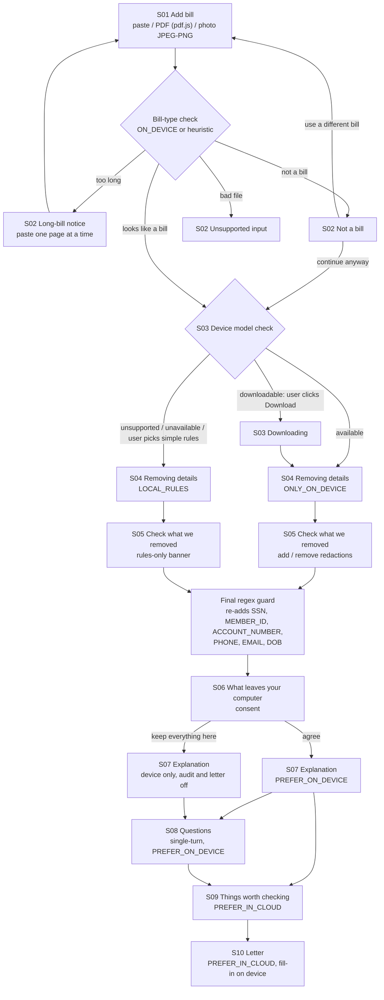
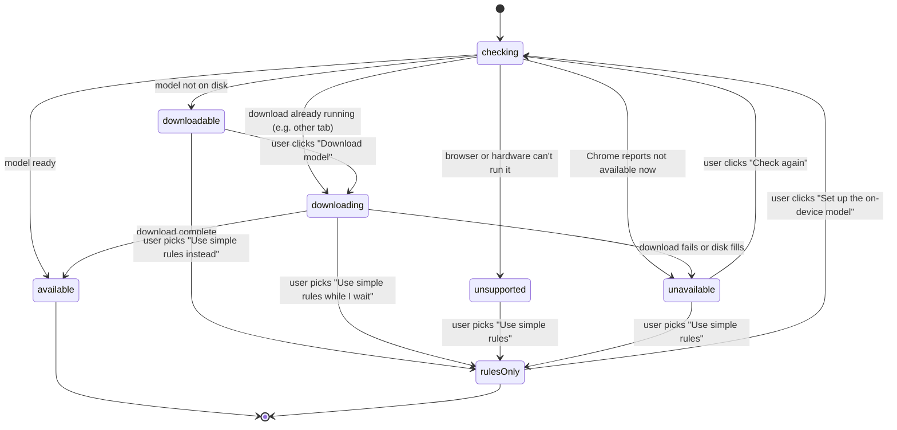
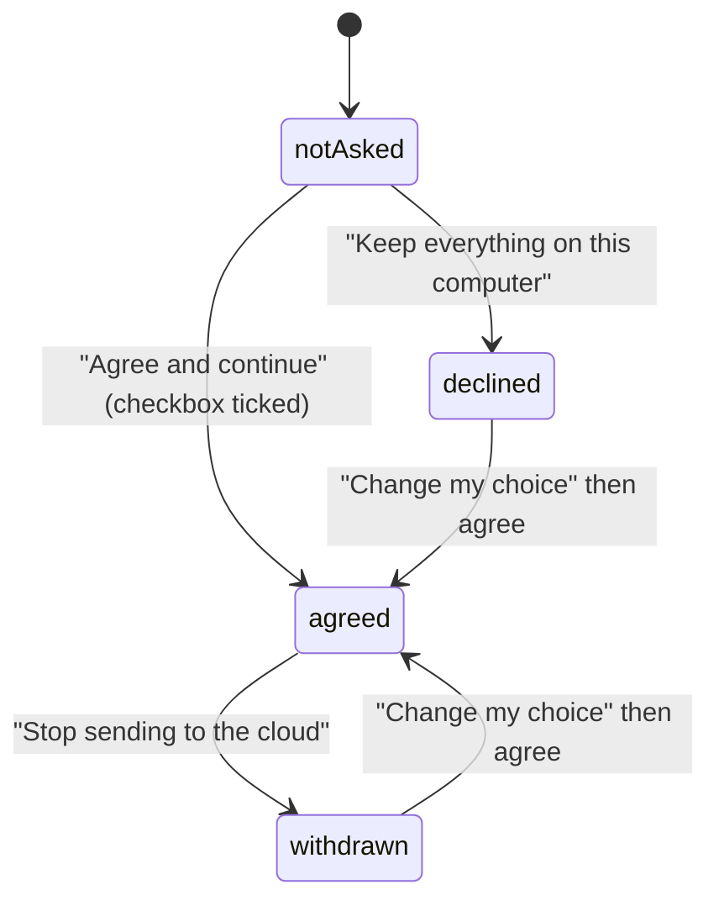

# ClearBill flows

This file describes the end-to-end flow, the device model states, and how special states and errors branch off the main path. Screen IDs (S01 and so on) match the files in [`wireframes/`](wireframes/README.md). String keys refer to [`copy.json`](copy.json).

## 1. The main path

Notes on the path:

1. **The guard runs on Continue from S05**, not later. S06 shows the text after the guard, so what the user agrees to is exactly what can be sent.
2. **Consent comes before the explanation**, as agreed in the Design Review. The explanation prefers the device, but `PREFER_ON_DEVICE` can fall back to the cloud. Asking first means no fallback ever sends text the user hasn't approved. If the user declines, the app calls the explanation and questions with `ONLY_ON_DEVICE` instead (see open question F1).
3. **Explanation, Questions, Audit and Letter are a tabbed results area** after S06. The step bar lets the user move between them freely. They are not a forced sequence after consent.
4. **Questions are single-turn.** Each question is sent with the redacted bill as context and no earlier questions. The UI says so (`questions.intro`, `questions.standsAlone`) and shows past answers as separate cards, not as a chat thread.
5. **Start over** is always available in the header. It clears everything in the tab after a confirm dialog.

### Which step uses which mode

| Step | Inference mode | Badge sources possible | Needs consent |
|---|---|---|---|
| Bill-type check | `ONLY_ON_DEVICE`, heuristic fallback | `ON_DEVICE`, `LOCAL_RULES` | No |
| Remove details | `ONLY_ON_DEVICE`, regex fallback | `ON_DEVICE`, `LOCAL_RULES` | No |
| Final guard | regex | `LOCAL_RULES` | No |
| Explain lines | `PREFER_ON_DEVICE` (or `ONLY_ON_DEVICE` if declined) | `ON_DEVICE`, `IN_CLOUD` | Only if it could reach the cloud |
| Questions | `PREFER_ON_DEVICE` (or `ONLY_ON_DEVICE` if declined) | `ON_DEVICE`, `IN_CLOUD` | Only if it could reach the cloud |
| Audit | `PREFER_IN_CLOUD` | `IN_CLOUD`, `ON_DEVICE` | Yes |
| Letter | `PREFER_IN_CLOUD` | `IN_CLOUD`, `ON_DEVICE` | Yes |
| Fill in my details (letter) | local find-and-replace | `LOCAL_RULES` | No |

## 2. Device model states

`DeviceModelState` is `'unsupported' | 'unavailable' | 'downloadable' | 'downloading' | 'available'`. The download starts only when the user clicks **Download model**. Progress may be indeterminate.

`checking` and `rulesOnly` are UI states, not `DeviceModelState` values. `checking` shows `deviceModel.checking` for at most a moment. `rulesOnly` means "the user chose to go on without the model".

| State | What the user sees (S03) | Primary action | Secondary action | Under the hood value |
|---|---|---|---|---|
| `unsupported` | `deviceModel.states.unsupported` | Use simple rules | What does my computer need? (expands the requirements) | Not supported |
| `unavailable` | `deviceModel.states.unavailable` | Use simple rules | Check again | Not available |
| `downloadable` | `deviceModel.states.downloadable` | Download model | Use simple rules instead | Not downloaded |
| `downloading` | `deviceModel.states.downloading`, progress bar (determinate) or moving stripe (indeterminate; static with reduced motion) | none, the download runs | Use simple rules while I wait | Downloading |
| `available` | `deviceModel.states.available` | Continue (shown only after a download the user started; nothing moves on by itself) | none | Ready |

Returning users with the model already downloaded never see S03: the app goes from S01 straight to S04 and records the state in Under the hood.

If the model finishes downloading while the user is in rules-only mode, a polite banner says `deviceModel.downloadDone` and offers **Run again with the on-device model** on S05 (see open question F2).

## 3. Consent states

- Consent is per bill, per tab (`consent.scope`). Start over resets it to `notAsked`.
- Any cloud-bound call while the state is not `agreed` returns `CONSENT_REQUIRED`, and the UI shows `errors.CONSENT_REQUIRED` with a link back to S06.
- Editing redactions after agreeing (going back to S05) resets consent to `notAsked`, because the text has changed.

## 4. Special states

| State | Trigger | Where it shows | Wireframe |
|---|---|---|---|
| Rules-only fallback | Model `unsupported` or `unavailable`, or the user chose simple rules | Banner on S04 and S05, `LOCAL_RULES` badge on the redaction pass, extra nudge to look for names and diagnoses | S05b |
| Not a bill | Bill-type check says not medical | Full step screen after S01 | S02b |
| Long bill | `INPUT_TOO_LONG`, or the text is over the device model's limit | Full step screen after S01 | S02a |
| Kill switch | Remote Config turns cloud features off | Banner on all result screens, audit and letter cards replaced by a paused notice, consent screen shows only the on-device choice | S11 |
| Offline | `navigator.onLine` is false, or a `NETWORK` error | Banner; cloud actions disabled with a reason | S12 (pattern) |

## 5. Errors

Every `AIErrorCode` has a title, body and at least one action in `copy.json` under `errors.<CODE>`. They use one pattern (S12): an inline alert in the card where the error happened, never a modal, never a dead end. Focus moves to the alert's heading.

| Code | Typical step | Recovery |
|---|---|---|
| `DEVICE_MODEL_NOT_READY` | Remove details, explain | Go to setup (S03) or use simple rules |
| `INPUT_TOO_LONG` | Bill-type check, remove details | Edit the text (back to S01 with the text kept) |
| `NOT_A_BILL` | Bill-type check | Different bill, or continue anyway |
| `UNSUPPORTED_INPUT` | Import | Choose another file |
| `CONSENT_REQUIRED` | Explain (fallback), questions, audit, letter | Review my choice (S06) |
| `SCHEMA_PARSE_FAILED` | Any model step | Try again |
| `SAFETY_BLOCKED` | Questions mostly | Edit my question |
| `QUOTA_OR_RATE_LIMIT` | Cloud steps | Try again after a wait; on-device still works |
| `APP_CHECK_FAILED` | Cloud steps | Reload page |
| `NETWORK` | Cloud steps | Try again |
| `KILL_SWITCH` | Audit, letter | OK; switches the screen to the kill-switch state |
| `ABORTED` | Any step the user stopped | Start it again |
| `UNKNOWN` | Any | Try again, or start over |
