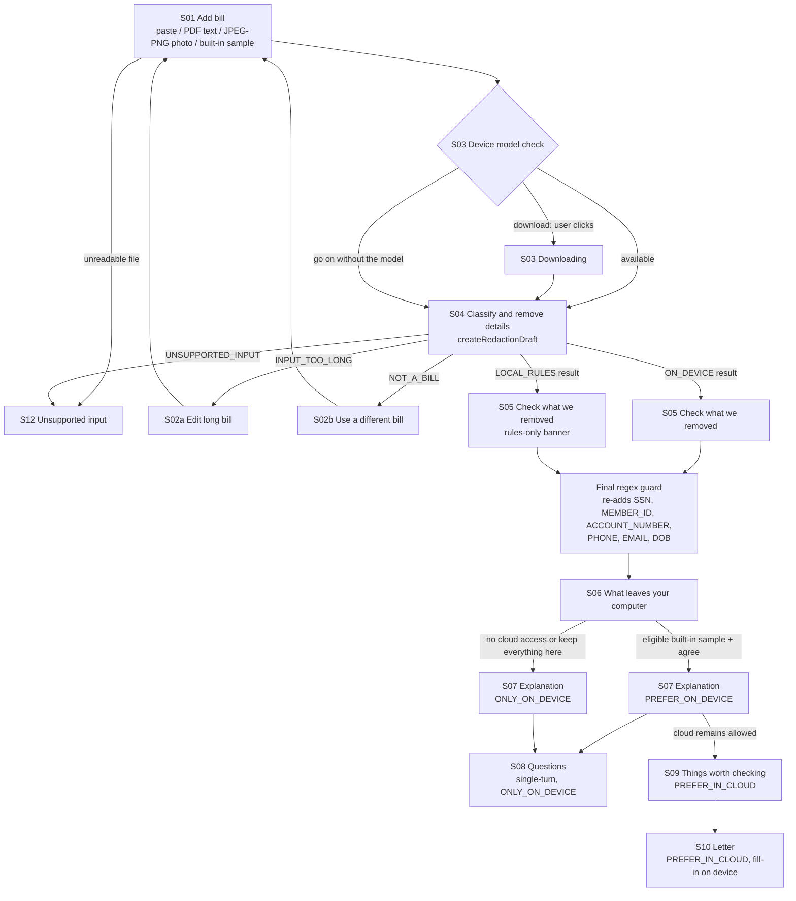
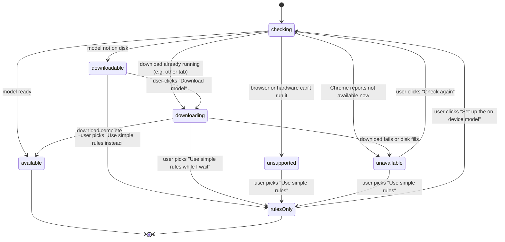
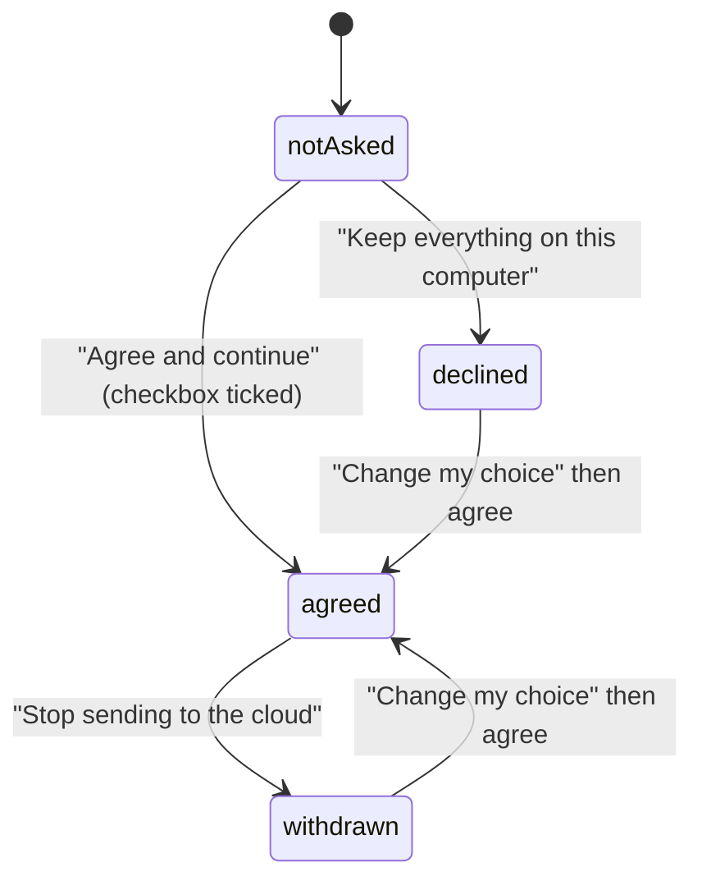

# ClearBill flows

This file describes the end-to-end flow, the device model states, and how special states and errors branch off the main path. Screen IDs (S01 and so on) match the files in [`wireframes/`](wireframes/README.md). String keys refer to [`copy.json`](copy.json).

## 1. The main path

Notes on the path:

1. **The built-in sample uses its own import action.** Pass `{kind: 'sample', sampleId}` using the public `SAMPLE_IDS`. The AI layer loads the bundled text and assigns its provenance. Pasted text, PDFs and photos always use user provenance, including pasted copies of the sample. Show the sample label throughout its flow.
2. **Continue from S05 previews the guarded text.** Call `approveRedaction` with `consentToCloud: false` and show its redacted text on S06. After eligible consent, repeat it with the same draft and review and `consentToCloud: true`. For the device-only choice, keep the preview's device-only approval.
3. **Consent comes before any cloud-capable explanation, audit or letter.** Explain and Questions stay accessible in the results area. Audit and Letter show the current availability reason when blocked. Only the AI layer sets modes and enforces the gate.
4. **Every typed question runs on the device.** `askQuestion` uses the redacted bill and the current question. Earlier questions remain separate answer cards on the device.
5. **Start over** clears the bill, consent, vault, answers and session log from the tab after a confirmation. Previously sent text cannot be recalled.

### Which step uses which mode

| Step | Inference mode | Badge sources possible | Needs consent |
|---|---|---|---|
| Classify and remove details | `ONLY_ON_DEVICE`, or `NONE` for regex fallback | `ON_DEVICE`, `LOCAL_RULES` on success | No |
| Final guard | `NONE` | `LOCAL_RULES` | No |
| Explain lines | `PREFER_ON_DEVICE` when cloud is allowed, otherwise `ONLY_ON_DEVICE` | `ON_DEVICE`, `IN_CLOUD` | Only if it could reach the cloud |
| Questions | `ONLY_ON_DEVICE` | `ON_DEVICE` | No |
| Audit | `PREFER_IN_CLOUD` | `IN_CLOUD`, `ON_DEVICE` | Yes |
| Letter | `PREFER_IN_CLOUD` | `IN_CLOUD`, `ON_DEVICE` | Yes |
| Fill in my details (letter) | LocalVault rehydration | No source badge | No |

## 2. Device model states

`DeviceModelState` is `'unsupported' | 'unavailable' | 'downloadable' | 'downloading' | 'available'`. The download starts only when the user clicks **Download model**. Progress may be indeterminate.

`checking` and `rulesOnly` are UI states. `checking` shows `deviceModel.checking` briefly. A rules action starts S04 immediately, without waiting for the download. Use the actual result source to choose the review screen if availability changes in the meantime. For a photo, offer model setup or another import method instead of simple rules. `createRedactionDraft` can return `UNSUPPORTED_INPUT` if the model becomes unavailable.

| State | What the user sees (S03) | Primary action | Secondary action | Under the hood value |
|---|---|---|---|---|
| `unsupported` | `deviceModel.states.unsupported` | Use simple rules | What does my computer need? (expands the requirements) | Not supported |
| `unavailable` | `deviceModel.states.unavailable` | Use simple rules | Check again | Not available |
| `downloadable` | `deviceModel.states.downloadable` | Download model | Use simple rules instead | Not downloaded |
| `downloading` | `deviceModel.states.downloading`, progress bar (determinate) or moving stripe (indeterminate; static with reduced motion) | none, the download runs | Use simple rules while I wait | Downloading |
| `available` | `deviceModel.states.available` | Continue (shown only after a download the user started; nothing moves on by itself) | none | Ready |

Returning users with the model already downloaded never see S03: the app goes from S01 straight to S04 and records the state in Under the hood.

If the model finishes downloading while the user is in rules-only mode, `subscribeDeviceStatus` drives a polite banner `deviceModel.downloadDone`. **Run again with the on-device model** on S05 starts a fresh `createRedactionDraft` after confirming that current review edits will be replaced.

## 3. Consent states

- Consent is per bill, per tab (`consent.scope`). On S06, call `getCloudAvailability(provenance)`; before approval it reports the kill-switch, region and user-bill gates. After approval, pass the `ApprovedBill` so it also considers consent. The precedence is `kill_switch`, `region`, `user_bill`, then `no_consent`.
- Start with the checkbox unticked. With `kill_switch`, `region` or `user_bill`, show the matching notice and only the device choice. If the region config cannot be fetched, cloud remains off. Device explanations and questions need a ready model. Where Audit or Letter would appear, retain a visible reason and offer consent changes only for `no_consent`.
- Going back to edit or starting over resets consent to `notAsked` and discards the old approval. Withdrawal re-runs `approveRedaction` with `consentToCloud: false` and replaces the old approval. Future calls use the replacement. The UI never reuses the old approval or claims that earlier sends can be recalled.
- Audit and letter calls recheck the gate at call time. Show `KILL_SWITCH` for `kill_switch`, `CLOUD_NOT_ALLOWED` for `region` or `user_bill`, and `CONSENT_REQUIRED` for `no_consent`. Device-only explanation and questions with no ready model show `DEVICE_MODEL_NOT_READY`.

## 4. Special states

| State | Trigger | Where it shows | Wireframe |
|---|---|---|---|
| Rules-only fallback | Model `unsupported` or `unavailable`, or the user chose simple rules | Banner on S04 and S05, `LOCAL_RULES` badge on the redaction pass, extra nudge to look for names and diagnoses | S05b |
| Not a bill | `createRedactionDraft` returns `NOT_A_BILL` | Branch from S04, back to import | S02b |
| Long bill | `createRedactionDraft` returns `INPUT_TOO_LONG` after trying line-boundary chunking | Branch from S04, back to import with text intact | S02a |
| Kill switch | Remote Config turns cloud features off | Banner on all result screens, audit and letter cards replaced by a paused notice, consent screen shows only the on-device choice | S11 |
| Built-in sample only | Cloud availability reason `user_bill` | Device-only choice and reason on S06, audit and letter notices | S06, S09, S10 |
| Region unavailable | Cloud availability reason `region`, including unavailable region config | Device-only choice and reason on S06, audit and letter notices | S06, S09, S10 |
| Offline | `navigator.onLine` is false, or a `NETWORK` error | Banner; cloud actions disabled with a reason | S12 (pattern) |

## 5. Errors

Every `AIErrorCode` has a title, body and at least one action in `copy.json` under `errors.<CODE>`. They use one pattern (S12): an inline alert in the card where the error happened, never a modal, never a dead end. Focus moves to the alert's heading.

| Code | Typical step | Recovery |
|---|---|---|
| `DEVICE_MODEL_NOT_READY` | Explain, questions | Go to setup (S03) or view the text after removal |
| `INPUT_TOO_LONG` | Classify and remove details | Edit the text (back to S01 with the text kept) |
| `NOT_A_BILL` | Classify and remove details | Use a different bill (S01) |
| `UNSUPPORTED_INPUT` | Import or photo redaction | Choose another file or set up the model for the photo |
| `CONSENT_REQUIRED` | Audit, letter | Review my choice (S06) |
| `CLOUD_NOT_ALLOWED` | Audit, letter | Go to the explanation. Show the sample or region notice from `cloudReason` |
| `SCHEMA_PARSE_FAILED` | Any model step | Try again |
| `SAFETY_BLOCKED` | Questions mostly | Edit my question |
| `QUOTA_OR_RATE_LIMIT` | Cloud steps | Try again after a wait; on-device still works |
| `APP_CHECK_FAILED` | Cloud steps | Reload page |
| `NETWORK` | Cloud steps | Try again |
| `KILL_SWITCH` | Audit, letter | OK; switches the screen to the kill-switch state |
| `ABORTED` | Any step the user stopped | Start it again |
| `UNKNOWN` | Any | Try again, or start over |
