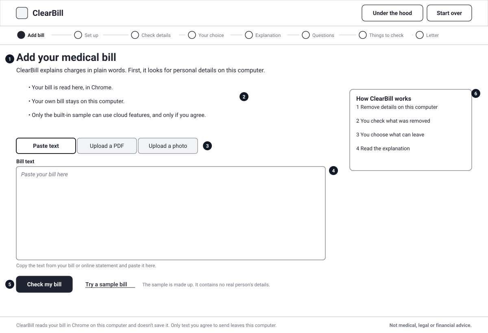

# S01: Add bill: paste text

**Purpose:** Start the flow. Explain the privacy promise in three short points before asking for anything.

**How you get here:** App opens, or the user picks Start over.

**Where it goes:**

- Check my bill → S03, or S04 when the model is already available.
- Try a sample bill → selects the built-in sample by its public sample ID and follows the same flow. It never puts the sample in the editable user-input field.

## Numbered elements

1. Title and intro (`import.title`, `import.intro`).
2. Privacy points (`import.privacyPoints`). Results get badges once actual inference runs.
3. Input method tabs (`import.tabsLabel`, `tabPaste`, `tabPdf`, `tabPhoto`).
4. Textarea (`import.pasteLabel`, `pastePlaceholder`, `pasteHint`). Character count appears bottom right once text is pasted.
5. Primary action `import.submit`. Separate sample button `import.trySample` with `import.sampleNote`. Keep `import.sampleLabel` visible throughout the sample flow.
6. Optional 'How it works' card. Reuses step names. Collapses under the form below 900px wide.

## States and variants

- Tab 'Upload a PDF' and 'Upload a photo' are shown in S01b.
- 'Check my bill' is disabled until there is text or a file. The reason shows under it (`import.submitDisabledHint`).

## Accessibility

- The three input methods are a WAI-ARIA tablist; arrow keys move between tabs.
- The privacy points are a plain list, read before the input.
- The sample button starts the sample flow and moves focus to the next heading.

All strings come from [`../copy.json`](../copy.json). The text in the SVG is a sample; the JSON wins if they differ.
