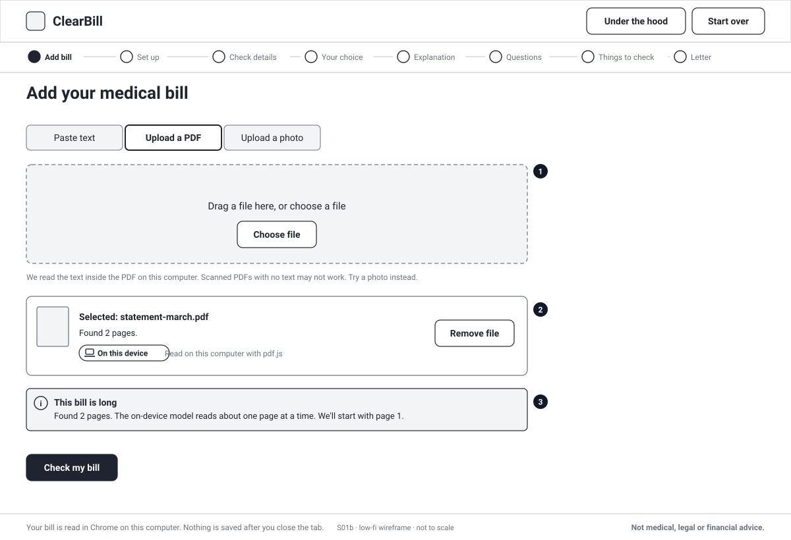

# S01b: Add bill: PDF or photo chosen

**Purpose:** Show a chosen file and the on-device reading step for PDFs (pdf.js) and photos (JPEG/PNG).

**How you get here:** User picks the PDF or photo tab and chooses or drops a file.

**Where it goes:**

- Check my bill → same as S01.
- Remove file → back to the empty drop zone.

## Numbered elements

1. Drop zone plus a real 'Choose file' button (`import.dropZone`, `import.chooseFile`). Hint below: `import.pdfHint` or `import.photoHint`.
2. Chosen-file card (`import.fileSelected`, `import.pagesFound_one/_other`, `import.removeFile`). State that pdf.js read the PDF text locally.

## States and variants

- While extracting PDF text, show `import.readingPdf`. A photo remains a selected JPEG or PNG until S04 reads it with the model.
- Unsupported type or a PDF with no text → inline `errors.UNSUPPORTED_INPUT` (see S12).
- S04's `INPUT_TOO_LONG` opens S02a. Returning to edit keeps all the text extracted from the PDF.

## Accessibility

- The drop zone is also a real file input with a visible 'Choose file' button; drag and drop is never the only way.
- After a file is read, focus stays on the 'Remove file' button and the page count is announced politely.

All strings come from [`../copy.json`](../copy.json). The text in the SVG is a sample; the JSON wins if they differ.
