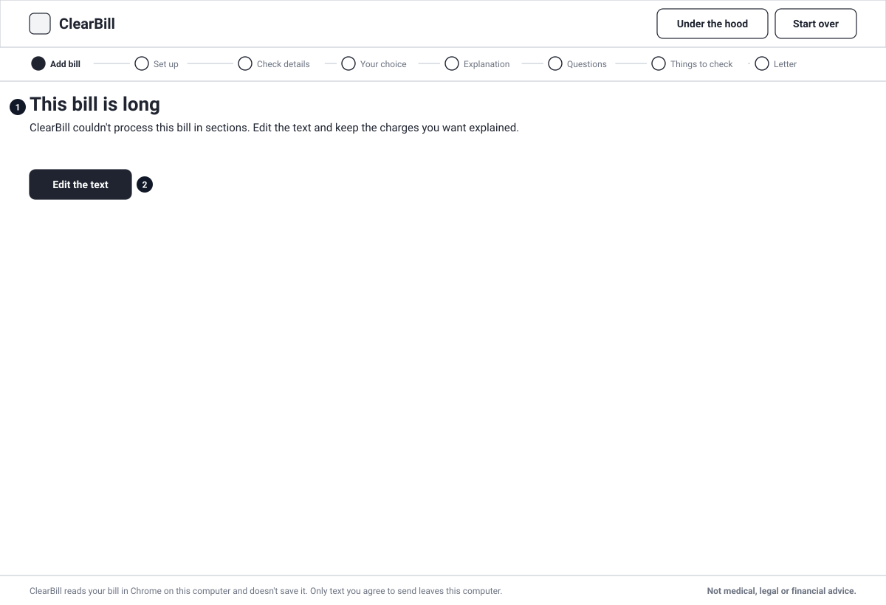

# S02a: Long-bill notice

**Purpose:** Let the user edit the text and retry if ClearBill could not process the bill in sections.

**How you get here:** S04's `createRedactionDraft` returns `INPUT_TOO_LONG`.

**Where it goes:**

- Edit the text → S01 with the full pasted or PDF text intact. Focus the text field so the user can edit and submit again. For a photo with no editable text, offer `errors.UNSUPPORTED_INPUT.primaryAction` to choose another file instead.

## Numbered elements

1. Title and body (`specialStates.longBill.title`, `.body`).
2. Recovery action `specialStates.longBill.primaryAction`.

## Accessibility

- Focus moves to the heading on arrival.

All strings come from [`../copy.json`](../copy.json). The text in the SVG is a sample; the JSON wins if they differ.
