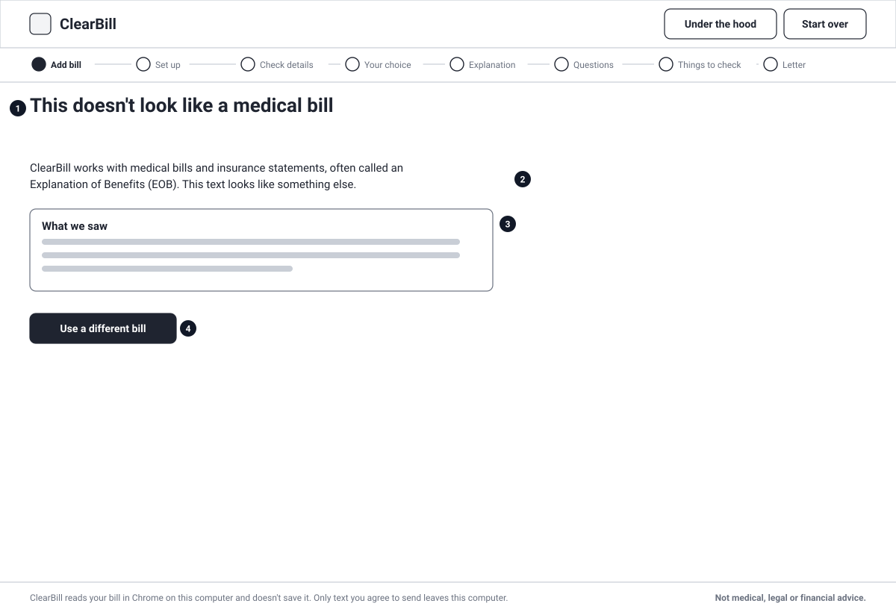

# S02b: Not a medical bill

**Purpose:** Tell the user the text doesn't look like a medical bill or EOB, without blocking them.

**How you get here:** Bill-type check returns `NOT_A_BILL`.

**Where it goes:**

- Use a different bill → S01 (text cleared).
- Continue anyway → S03 or S04.

## Numbered elements

1. Badge shows the bill-type check ran `ON_DEVICE` (or `LOCAL_RULES` for the heuristic fallback).
2. Body `specialStates.notABill.body`. Defines EOB in plain words.
3. A short preview of the start of the text, so the user can see if they pasted the wrong thing.
4. Actions. 'Continue anyway' is always offered: the classifier can be wrong.

## Accessibility

- Focus moves to the heading.
- The badge tells a screen reader the check ran locally.

All strings come from [`../copy.json`](../copy.json). The text in the SVG is a sample; the JSON wins if they differ.
