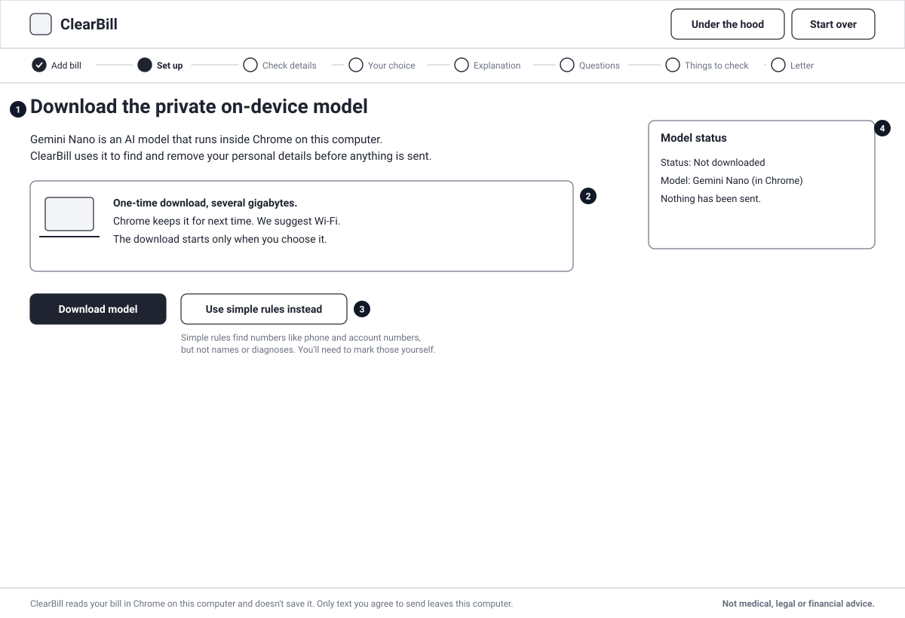

# S03a: Set up: model downloadable

**Purpose:** Explain the on-device model and let the user start the download. The download starts only on click.

**How you get here:** S01 finishes and the device model state is `downloadable`.

**Where it goes:**

- Download model → S03b.
- Use simple rules instead → S04 in rules-only mode.

## Numbered elements

1. Title `deviceModel.states.downloadable.title` and explainer `deviceModel.whatItIs`.
2. Download facts (`deviceModel.states.downloadable.body`). No exact size is promised.
3. Choice: `primaryAction`, `secondaryAction`, `secondaryHint`. The trade-off of simple rules is stated before the choice.
4. Mini status card mirrors Under the hood (`underTheHood.deviceStateValues.downloadable`).

## States and variants

- `unsupported` and `unavailable` use the same layout, see S03c.
- Returning users with a ready model skip S03.
- Photos need the device model. Offer another import method instead of simple rules when the selected input is a photo.

## Accessibility

- The two choices are buttons of equal size; the secondary hint is tied to its button with `aria-describedby`.
- No timer, no auto-start.

All strings come from [`../copy.json`](../copy.json). The text in the SVG is a sample; the JSON wins if they differ.
