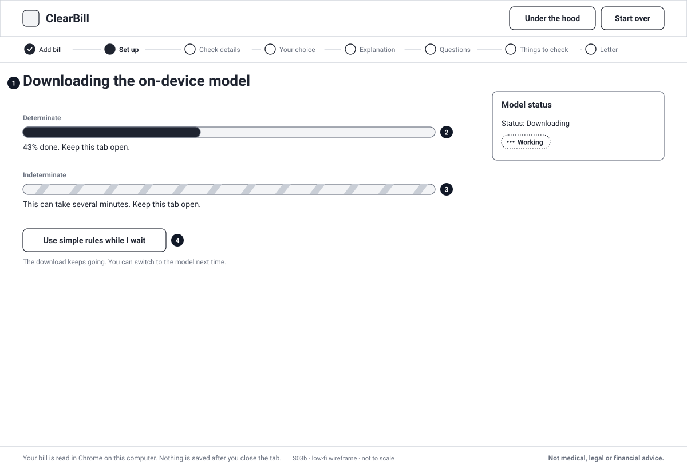

# S03b: Set up: model downloading

**Purpose:** Show download progress, determinate or indeterminate, and let the user go on with simple rules meanwhile.

**How you get here:** User clicked Download model, or a download was already running.

**Where it goes:**

- Download completes → S03d.
- Use simple rules while I wait → S04 rules-only; the download keeps going.
- Download fails → S03c (`unavailable`).

## Numbered elements

1. Title `deviceModel.states.downloading.title`.
2. Determinate bar with `bodyProgress`.
3. Indeterminate bar with `bodyIndeterminate`. Stripes don't move when reduced motion is on.
4. `secondaryAction` with `secondaryHint`. There is no Cancel: Chrome manages the download.

## States and variants

- Determinate: filled bar with `bodyProgress` ('{percent}% done').
- Indeterminate: a striped bar that slides; with reduced motion it is a static striped bar and the text says `bodyIndeterminate`.

## Accessibility

- Bar is `role=progressbar` with `aria-valuenow` when known; no `aria-valuenow` when indeterminate.
- Progress is announced politely at most every 25% (`srProgressUpdate`), not every tick.

All strings come from [`../copy.json`](../copy.json). The text in the SVG is a sample; the JSON wins if they differ.
