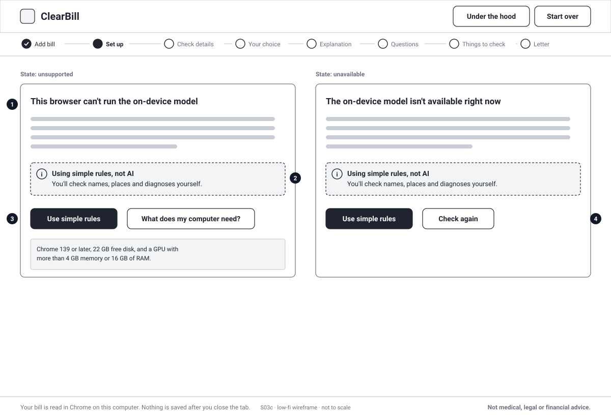

# S03c: Set up: unsupported or unavailable

**Purpose:** Explain that the on-device model can't run, without blame, and offer simple rules.

**How you get here:** Model state is `unsupported` or `unavailable`.

**Where it goes:**

- Use simple rules → S04 rules-only.
- Check again (unavailable only) → re-check the model state.
- What does my computer need? (unsupported only) → expands the requirements in place.

## Numbered elements

1. Title and body per state (`deviceModel.states.unsupported` / `.unavailable`).
2. Preview of what simple rules mean (`specialStates.rulesOnly`), with a dashed border to match the LOCAL_RULES badge.
3. Actions. 'What does my computer need?' expands `requirements` (shown open). See the current [Chrome hardware requirements](https://developer.chrome.com/docs/ai/get-started#required_hardware).
4. 'Check again' re-runs the availability check and shows `deviceModel.checking` briefly.

## States and variants

- Left: `unsupported`. Right: `unavailable`. Same layout, different copy and secondary action.

## Accessibility

- The requirements disclosure is a `button` with `aria-expanded`.
- No red colouring: this is not the user's fault.

All strings come from [`../copy.json`](../copy.json). The text in the SVG is a sample; the JSON wins if they differ.
