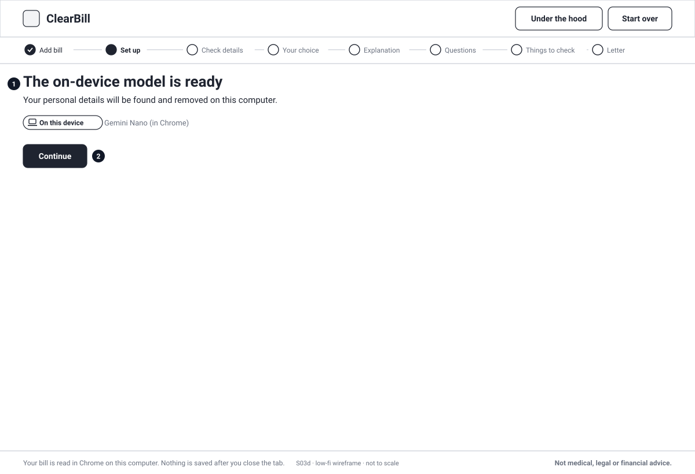

# S03d: Set up: model ready

**Purpose:** Confirm the download finished. The user moves on when ready; nothing advances by itself.

**How you get here:** Download finished (state `available`) after the user started it.

**Where it goes:**

- Continue → S04 (on-device).

## Numbered elements

1. Title and body (`deviceModel.states.available`). Badge introduces the 'On this device' label.
2. Single primary action. Focus lands here.

## Accessibility

- `deviceModel.states.available.srAnnounce` is announced politely; focus moves to Continue.

All strings come from [`../copy.json`](../copy.json). The text in the SVG is a sample; the JSON wins if they differ.
