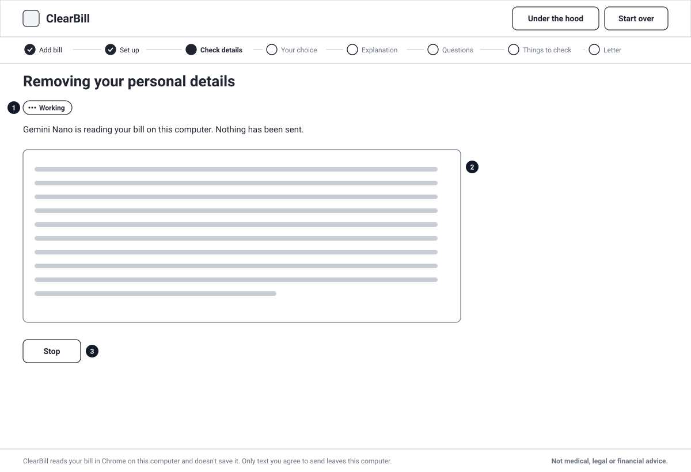

# S04: Removing details

**Purpose:** Short wait while redaction runs locally. Reassure that nothing has been sent.

**How you get here:** After S01/S03 with a bill ready.

**Where it goes:**

- Done → S05 (or S05b in rules-only).
- Stop → S01 with `errors.ABORTED` (nothing was sent).

## Numbered elements

1. Live source badge and `redacting.bodyDevice`.
2. Skeleton of the bill text. No fake progress percentage.
3. `redacting.cancel`. Leads to ABORTED copy that says nothing was sent.

## States and variants

- On-device: `redacting.bodyDevice`, badge 'On this device'.
- Rules-only: `redacting.bodyRules`, badge 'Simple rules', plus the rules-only banner.

## Accessibility

- Container is `aria-busy=true`; a polite status message reads the body once.
- Skeleton shimmer is off with reduced motion.

All strings come from [`../copy.json`](../copy.json). The text in the SVG is a sample; the JSON wins if they differ.
