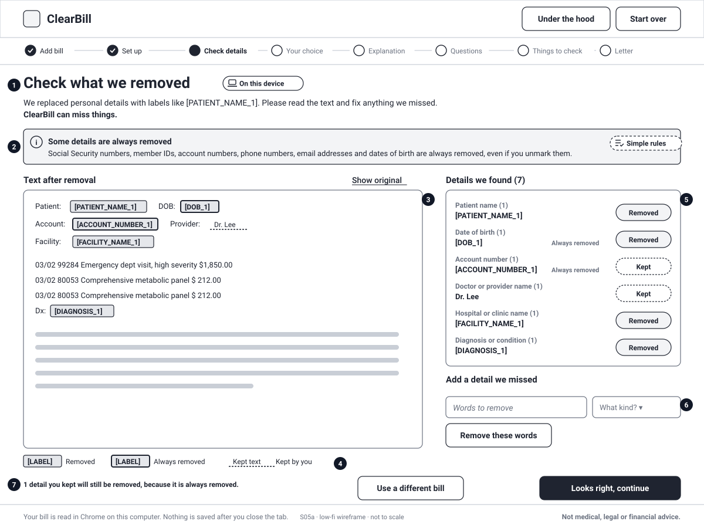

# S05a: Check what we removed (on-device)

**Purpose:** The core trust screen. Show every redaction in context, let the user keep or remove each, add missed ones, and explain the always-removed guard.

**How you get here:** Redaction finished on the device.

**Where it goes:**

- Looks right, continue → final regex guard → S06.
- Use a different bill → S01 (confirm).

## Numbered elements

1. Title, source badge for the redaction pass, intro `review.intro` (says plainly it can miss things).
2. Guard notice (`review.guardTitle`, `review.guardBody`) with a 'Simple rules' badge: the final guard is regex.
3. Preview region (`review.previewTitle`, `previewHint`). Focusable, scrollable, selectable. Selecting words shows a small 'Remove selected words' button. S06 shows the final guarded text before any sample cloud consent.
4. Legend (`highlight.visibleLegend*`). Three treatments that differ in shape, not only colour.
5. Grouped list of found details (`review.listTitle`, `groupCount`, `pii.*.label`). Each row has a Keep/Remove toggle button (`aria-pressed`). Locked categories show 'Always removed' (`review.lockedTag`).
6. Add form (`review.addTitle`, `addTextLabel`, `addCategoryLabel`, `addButton`). The keyboard-friendly way to add a redaction; removes every match.
7. Guard-applied notice (`review.guardAppliedNotice_*`) appears only when the user kept a locked item. Then the actions.

## States and variants

- Show original / Show text after removal toggle on the preview.
- No details found: `review.summaryNone` replaces the summary and the list shows only the add form.
- Kept-but-guarded item: shows 'Always removed' tag and `review.guardAppliedNotice_*` above the Continue button.

## Accessibility

- See accessibility.md, section 'Review screen', for the full focus order and screen-reader labels.
- Highlights are not colour-only: removed = filled chip with placeholder text, kept = dashed underline, locked = thick border plus 'Always removed' tag.

All strings come from [`../copy.json`](../copy.json). The text in the SVG is a sample; the JSON wins if they differ.
