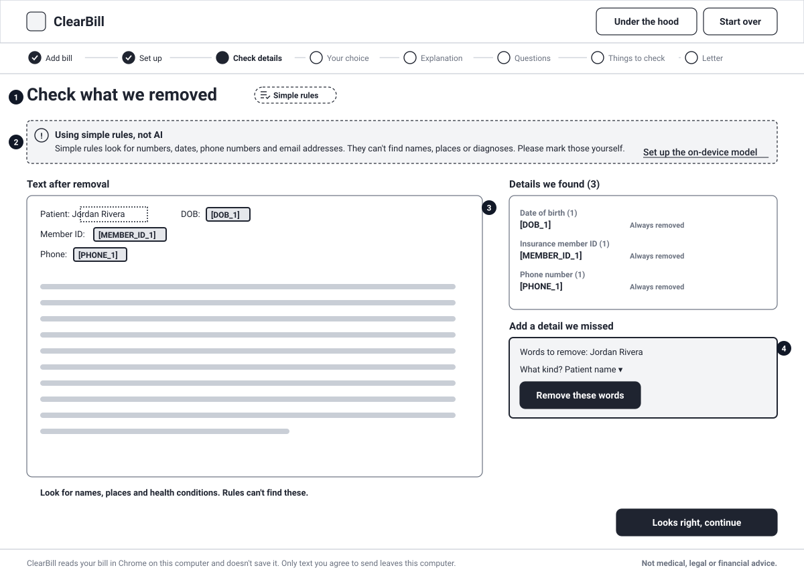

# S05b: Check what we removed (rules-only fallback)

**Purpose:** Same as S05a, but simple rules did the pass. Push the user to look for names, places and diagnoses.

**How you get here:** The user chose simple rules, or the model is unsupported or unavailable.

**Where it goes:**

- Same as S05a.
- Run again with the on-device model → S04 on-device (only when the model became available).

## Numbered elements

1. Source badge is 'Simple rules' (dashed border).
2. Rules-only banner (`specialStates.rulesOnly.bannerTitle`, `bannerBody`, `tryModel`).
3. Names are NOT found by rules. The nudge `specialStates.rulesOnly.reviewNudge` sits above the preview; there is no automatic highlight of likely names (we can't know them).
4. The add form is emphasised (thicker border) in rules-only mode, because the user does more of the work.

## Accessibility

- The rules-only banner is the first thing after the heading and is announced as a note, not an alert.

All strings come from [`../copy.json`](../copy.json). The text in the SVG is a sample; the JSON wins if they differ.
