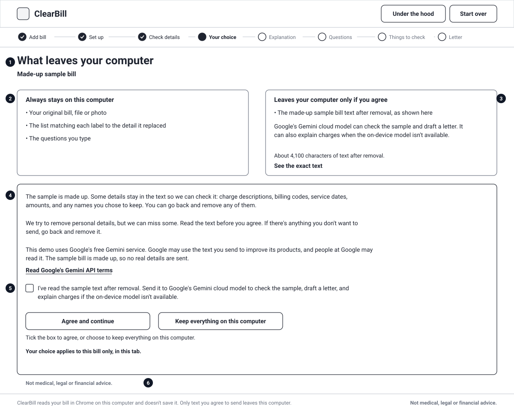

# S06: What leaves your computer (consent)

**Purpose:** Get informed, specific, reversible consent before any redacted text can reach the cloud.

**How you get here:** Continue on S05. Preview `approveRedaction(draft, review)` with `consentToCloud: false` and evaluate `getCloudAvailability(provenance)` for the layout.

**Where it goes:**

- Agree and continue (checkbox ticked, eligible sample only) → re-run `approveRedaction` with the same draft and review and `consentToCloud: true`, then go to S07.
- Keep everything on this computer → S07 with the existing device-only approval.
- Back → S05 (consent resets).

## Numbered elements

1. Title and intro (`consent.title`, `consent.intro`) with the made-up sample label when applicable.
2. What stays (`consent.staysTitle`, `staysItems`), including questions the user types.
3. For an eligible sample, what leaves (`consent.leavesTitle`, `leavesItems`, `leavesWhere`, `leavesSize`) and a disclosure with the exact guarded text (`viewText`).
4. Inside the consent card above the checkbox, show `consent.keptOnPurpose`, `consent.notPerfect`, and `consent.notStored` at body size. Use `consent.termsLink` for the [Gemini API terms](https://aistudio.google.com/docs/terms#data-use-unpaid).
5. Consent control: initially unticked checkbox `agreeLabel`, `agreeButton`, `declineButton` with `declineHint`, and `scope`. Editing the review resets the choice.
6. Full disclaimer link (`disclaimers.full`) sits under the decision.

## States and variants

- For `kill_switch`, `region`, or `user_bill`, replace the cloud disclosure and controls with the matching notice (`specialStates.killSwitch.bannerBody`, `specialStates.regionUnavailable.body`, or `specialStates.cloudSampleOnly.body`). Only the device choice is offered. A failsafe region check can block cloud without knowing the user's location.
- Model unavailable on the device-only path: use `consent.declineNoDevice`. Keep the text after removal available and offer model setup.
- For rules-only redaction, add `specialStates.rulesOnly.reviewNudge` above the preview and keep an easy route back to S05.

## Accessibility

- 'Agree and continue' uses `aria-disabled="true"` until the checkbox is ticked. Block the action in its handler and show `agreeButtonDisabledHint`.
- Focus order: heading, stays and leaves, 'See the exact text', terms link, checkbox, Agree, Keep everything here. The checkbox references both disclosure notes with `aria-describedby`.
- Both choices are buttons of equal visual weight. Declining is never a small link.

All strings come from [`../copy.json`](../copy.json). The text in the SVG is a sample; the JSON wins if they differ.
