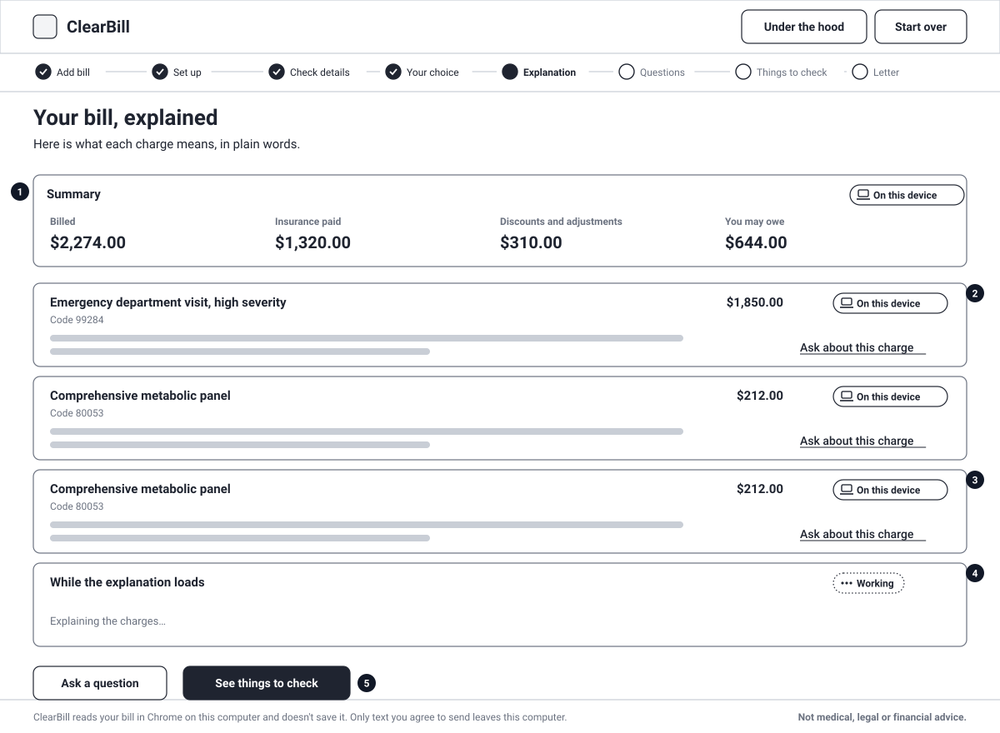

# S07: Your bill, explained

**Purpose:** Explain each line in plain words, show where each answer was made, and lead to questions and the audit.

**How you get here:** After S06 (either choice).

**Where it goes:**

- Ask a question / Ask about this charge → S08 (prefilled).
- See things to check → S09 when cloud is allowed. Otherwise show the reason from `getCloudAvailability(approvedBill)`.

## Numbered elements

1. Summary card (`explain.summaryTitle`, `totalBilled`, `insurancePaid`, `adjustments`, `youOwe`). 'You may owe', never 'You owe'.
2. Line card: description as heading, code (`explain.lineCode`), amount, plain explanation (`lineWhatItIs`, `lineWhyCharged`), source badge.
3. One `explainBill` result supplies the summary and line cards. All badges use that result's source.
4. The separate pending card illustrates the loading state. While loading, use the 'Working' badge and `explain.explaining`. Show the result cards when the validated response arrives.
5. Next actions (`explain.nextQuestions`, `explain.nextAudit`).

## States and variants

- With cloud allowed for the sample, the explanation prefers the device. A cloud fallback shows 'In the cloud' on the summary and line cards. On all other paths it is device-only.
- No line items found: `explain.noLines` and only the summary card.
- Device model unavailable on a device-only path: show `DEVICE_MODEL_NOT_READY`, preserve the text after removal, and offer setup. Keep the audit availability reason visible.

## Accessibility

- Each line is an `article` with a heading (the description) so screen-reader users can jump by heading.
- Amounts are read as money (use real text, not images).

All strings come from [`../copy.json`](../copy.json). The text in the SVG is a sample; the JSON wins if they differ.
