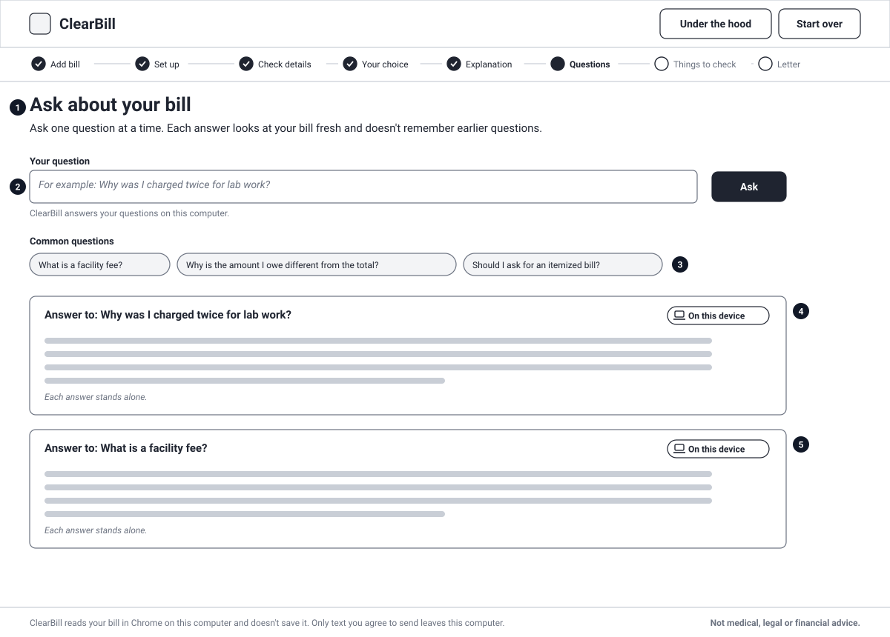

# S08: Ask about your bill (single-turn)

**Purpose:** Answer one question at a time against the redacted bill. Make it obvious each answer stands alone.

**How you get here:** From S07 or the step bar. 'Ask about this charge' prefills the question.

**Where it goes:**

- See things to check → S09.

## Numbered elements

1. Title and the single-turn explanation (`questions.intro`).
2. Single input and Ask button. Hint `questions.inputHint` warns about typing personal details.
3. Suggestion chips (`questions.suggestions`). Clicking one fills the input; it doesn't send.
4. Answer card: heading repeats the question, source badge, `questions.standsAlone`. Cards are a list, not a chat thread.
5. An answer that needed the cloud shows 'In the cloud'. Only possible when consent was given.

## States and variants

- PII warning: if the question looks like it contains a name or ID, `questions.piiWarning` appears with a 'Remove it' button before sending.
- Device can't answer and consent declined: `questions.cloudNeededDeclined`.
- SAFETY_BLOCKED: inline alert under the question (S12 pattern).

## Accessibility

- Answers are separate `article`s, newest first, each with 'Answer to: {question}' as its heading.
- The new answer gets focus on its heading when it lands, not on every streamed token.

All strings come from [`../copy.json`](../copy.json). The text in the SVG is a sample; the JSON wins if they differ.
