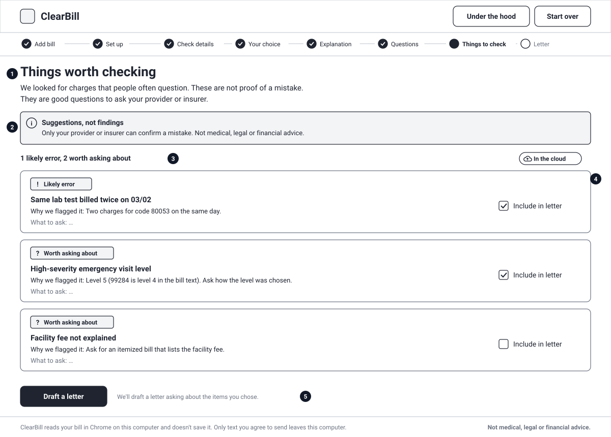

# S09: Things worth checking (audit)

**Purpose:** Show audit flags as questions to ask, not accusations. Let the user pick which go in the letter.

**How you get here:** From S07/S08 or the step bar. Requires consent; otherwise CONSENT_REQUIRED.

**Where it goes:**

- Draft a letter → S10 with the chosen flags.

## Numbered elements

1. Title and intro (`audit.title`, `audit.intro`).
2. Audit disclaimer (`disclaimers.audit` plus `disclaimers.short`).
3. Count summary (`audit.countSummary`) and the source badge for the audit call.
4. Flag card: severity tag (`audit.severity.*.label`), title, `flagWhy`, `flagAsk`, `includeInLetter`. Never the word 'error' alone.
5. `audit.makeLetter`, `audit.makeLetterHint`.

## States and variants

- Running: `audit.running` with pending badge.
- No flags: `audit.noFlags`.
- Kill switch: the whole list is replaced by `specialStates.killSwitch.auditCard` (see S11).
- Declined consent: `explain.auditOffDeclined` with 'Change my choice'.

## Accessibility

- Severity is a text tag with an icon, never colour alone. Flags sort likely errors first.
- 'Include in letter' is a checkbox per flag with the flag title as its accessible name.

All strings come from [`../copy.json`](../copy.json). The text in the SVG is a sample; the JSON wins if they differ.
