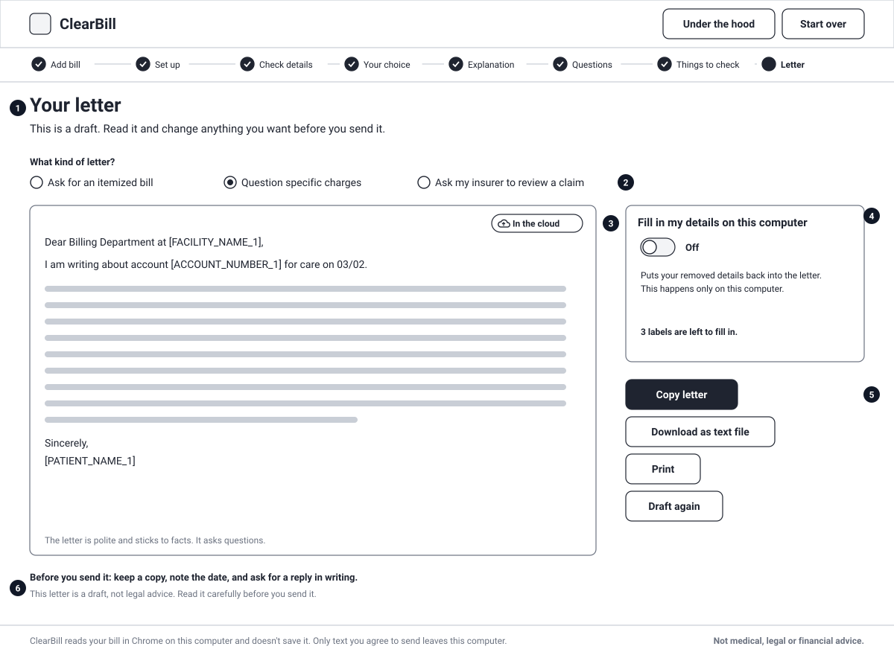

# S10: Your letter

**Purpose:** Give an editable, polite draft letter and put the user's real details back in on the device.

**How you get here:** Draft a letter on S09 for a cloud-eligible sample. If cloud becomes unavailable, show its current availability reason.

**Where it goes:**

- Copy, download as .txt, or print. Start over in the header.

## Numbered elements

1. Title and intro (`letter.title`, `letter.intro`).
2. Letter type radio group (`letter.typeLabel`, `typeItemized`, `typeDispute`, `typeAppeal`). Changing it asks before redrafting.
3. Editable letter (`letter.editorLabel`) with source badge. Placeholders stay until the user fills them in.
4. Fill-in switch (`letter.fillDetails`, `fillDetailsHint`, `placeholdersLeft_*`). Uses `LocalVault.rehydrate()` on this computer and shows a plain local-use description.
5. Output actions (`letter.copy`, `download`, `print`, `regenerate`).
6. `letter.nextSteps` and `disclaimers.letter`.

## States and variants

- Drafting: `letter.drafting` with pending badge. `draftLetter` receives the eligible approved sample, selected audit flags and letter type. Discard any unsent editor changes only after confirmation. Never pass editor text or rehydrated details to the model when drafting again.
- Fill-in off: placeholders like [ACCOUNT_NUMBER_1] visible and counted (`placeholdersLeft_*`).
- Fill-in on: values are filled back in locally and `fillDetailsOn` describes that action.

## Accessibility

- The letter is a labelled multi-line textbox (`letter.editorLabel`).
- The fill-in switch is a `role=switch` with its hint tied by `aria-describedby`.
- 'Copied' is announced politely.

All strings come from [`../copy.json`](../copy.json). The text in the SVG is a sample; the JSON wins if they differ.
