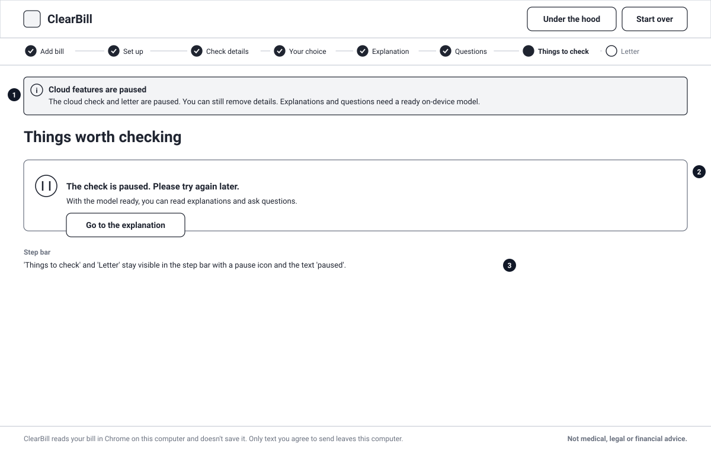

# S11: Kill switch: cloud features paused

**Purpose:** When Remote Config turns cloud features off, keep the on-device product working and say plainly what is paused.

**How you get here:** Remote Config flag is on at load, or a call returns `KILL_SWITCH`.

**Where it goes:**

- The user can view the text after removal, or use explanations and questions if the on-device model is ready.

## Numbered elements

1. Kill-switch banner (`specialStates.killSwitch.bannerTitle`, `bannerBody`).
2. Paused card replaces the audit list (`specialStates.killSwitch.auditCard`). A pause icon, not a warning icon.
3. The step bar keeps the steps, so the product still reads as complete; they're marked paused instead of hidden.

## States and variants

- On S06 the agree section is replaced by the banner, and only 'Keep everything on this computer' remains. With no ready model, offer setup and keep the text after removal available.
- In Under the hood: 'Cloud features: Paused'.

## Accessibility

- Banner is `role=status` (polite), shown once per session at the top of the results area, not repeated on every card.

All strings come from [`../copy.json`](../copy.json). The text in the SVG is a sample; the JSON wins if they differ.
