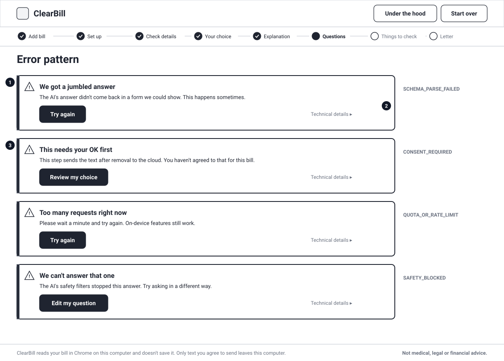

# S12: Error pattern (all AIErrorCodes)

**Purpose:** One inline error pattern for every AIErrorCode. Shows examples; the full copy is in copy.json under errors.

**How you get here:** Any step that fails.

**Where it goes:**

- Primary action per code (see flows.md section 5).

## Numbered elements

1. Alert anatomy: thick border plus left bar plus warning shape (not colour alone), title (`errors.<CODE>.title`), body, one primary action.
2. 'Technical details' disclosure shows `errors.detailsCode`.
3. CONSENT_REQUIRED links back to S06. It's a request, styled the same but with calm wording.

## States and variants

- Inline in the card where the step failed (shown).
- Offline banner (`specialStates.offline`) at the top of the page.

## Accessibility

- Inline alerts use `role=alert` only for failures the user caused by an action (Ask, Draft); background failures use `role=status`.
- Focus moves to the alert heading after a user action fails.
- 'Technical details' is a disclosure showing `errors.detailsCode`; codes are never the main message.

All strings come from [`../copy.json`](../copy.json). The text in the SVG is a sample; the JSON wins if they differ.
