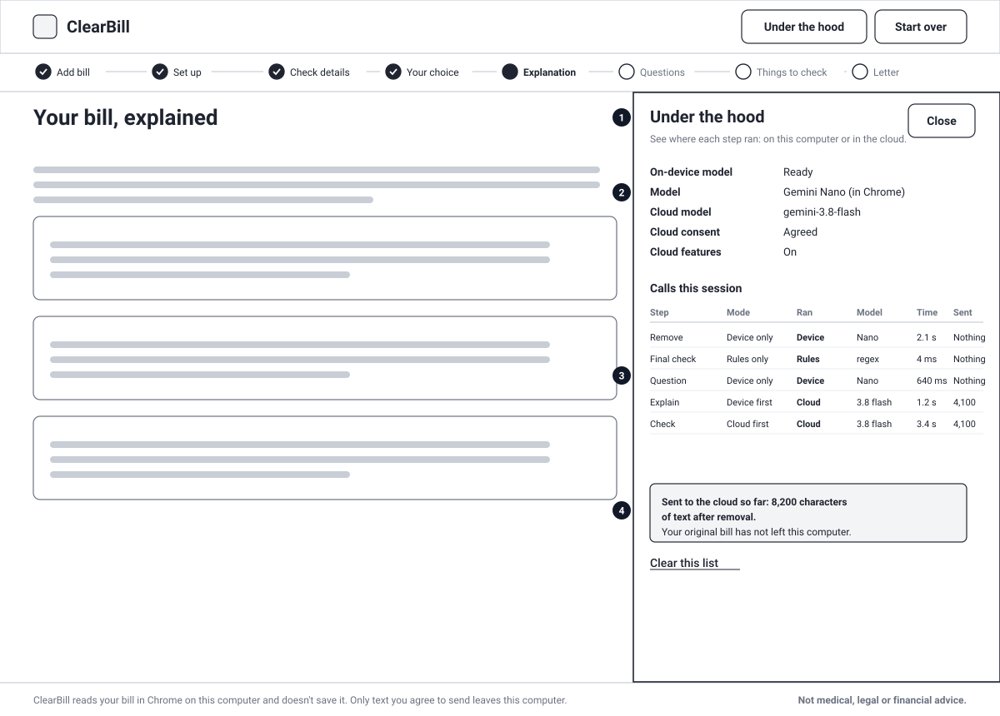

# S13: Under the hood panel

**Purpose:** Show judges and curious users exactly where each step ran: device model state, consent, and a per-call log with mode, source, model and latency.

**How you get here:** 'Under the hood' button in the header, on any screen.

**Where it goes:**

- Close (Escape, the close button, or the header button again).

## Numbered elements

1. Panel heading and intro (`underTheHood.title`, `underTheHood.intro`).
2. Status block: `deviceStateLabel` with `deviceStateValues.*`, `deviceModelValue`, `cloudModelLabel`, `consentValues.*`, `killSwitchValues.*`.
3. Call log table (`callsSection`, `columns.*`, `stepNames.*`, `modeValues.*`, `latencyValue`, `sentValue`). 'Mode' uses `AIResult.mode`. 'Ran' uses the source badge for the result. Log one row for the combined classify/redact pass and `NONE` for the final rules check. Question rows always have mode `ONLY_ON_DEVICE`, source `ON_DEVICE` on success, and zero sent characters.
4. Running total (`totalSent` / `totalSentNone`) and `rawNeverSent`. The core hybrid story in one sentence.

## States and variants

- Below 900px wide the panel becomes a full-width sheet over the page.
- Before any calls: `underTheHood.callsEmpty`.

## Accessibility

- Non-modal side panel (`complementary` landmark, labelled 'Under the hood'); the page stays usable. Opening moves focus to the panel heading; closing returns focus to the toggle.
- The call log is a real `table` with column headers; new rows are not announced.
- Latency is text ('412 ms'); no charts.

All strings come from [`../copy.json`](../copy.json). The text in the SVG is a sample; the JSON wins if they differ.
